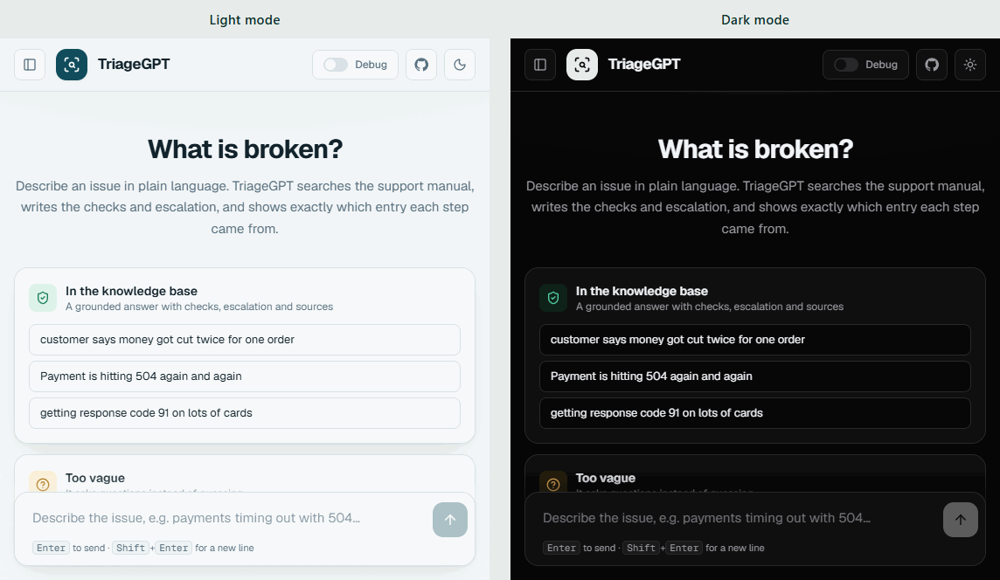
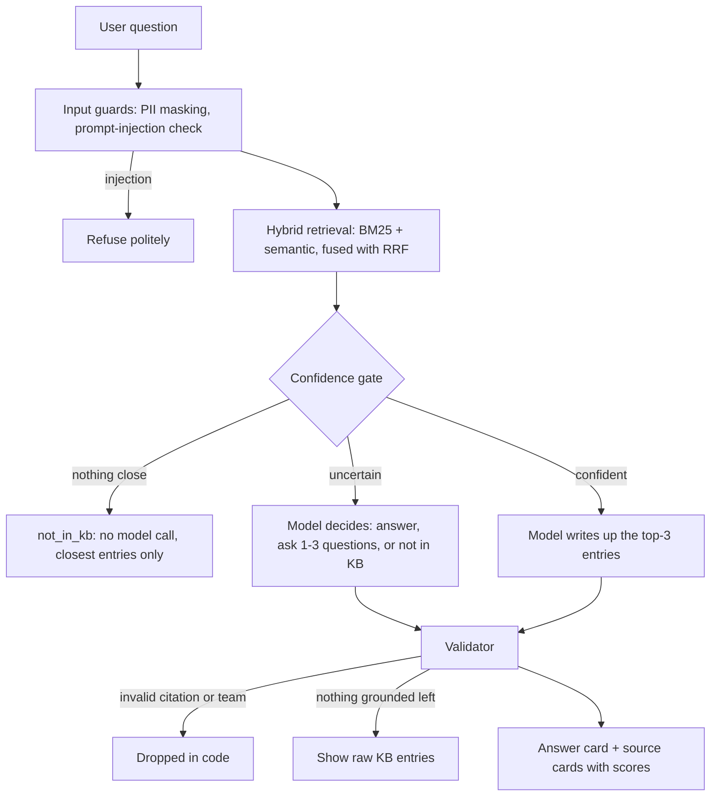

# TriageGPT: AI Troubleshooting Assistant for L1/L2 Support

**Live demo: <https://triage-gpt-seven.vercel.app/>**

A chat and search tool for support engineers. Describe an issue in plain language and the app finds the
relevant entries in a support knowledge base (KB), writes up step-by-step checks and an escalation team
from those entries, and shows exactly which entry each statement came from. When the KB does not cover
the issue it says so instead of guessing.

> **Sample data.** The KB is the manual of a fictional company, Northwind Payments. Every system, team,
> error code and procedure is simulated. It is not Pine Labs data.

The idea in one line: **the AI writes the answer, it does not decide what is true.** Retrieval and code
decide what the KB supports; the model only writes it up, and code checks the result.

<p align="center">
  
</p>

<p align="center"><sub>One prompt, run in light and dark mode: the staged search, then checks, escalation routes and cited sources. The panes use a compact width so the text stays readable side by side.</sub></p>

## Using it

- **Ask** in plain language. Answers list likely causes, L1/L2 checks, the resolution and every escalation
  route with what to attach, and each statement links to the manual entry it came from.
- **New chat** starts a fresh conversation. The button is in the header and at the top of the sidebar.
- **Chat history** is the left sidebar, grouped by Today, Yesterday, Previous 7 days and Older. Click a chat
  to review it exactly as it was, open its sources, or delete it. It keeps the 50 most recent chats.
- **Privacy.** History is stored in your own browser (localStorage), never on a server, so other visitors
  cannot see your questions. Card numbers, OTPs and CVVs are masked before anything is saved, and only a
  slim copy of each source is kept; the full entry is fetched again when you open it.
- **Under the hood** (header switch) shows the pipeline for the latest answer: guards, retrieval, gate,
  model and validation.
- **Themes.** Light by default; the moon icon switches to a near-black dark theme and the choice is remembered.
- **Links.** `/?q=payment+failing` asks a question on load; add `&debug=1` to open the pipeline view or
  `&theme=dark` to pick a theme.

## How it works



1. **Parse.** `lib/kb/parse.ts` turns the manual (67 entries, 15 teams, 4 priority levels) into structured data.
2. **Retrieve.** MiniSearch (BM25 with field boosts, prefix and fuzzy matching) catches exact codes such as
   `RC 91` or `504`. `bge-small-en-v1.5` embeddings catch paraphrases. Reciprocal Rank Fusion merges the two.
3. **Gate.** A deterministic rule on the scores of the entry fused ranking put first has three outcomes:
   nothing close (refuse, and the model is never called), confident (semantic and keyword support), or
   uncertain, in which case the model sees the candidates and chooses between answering, asking questions, or
   saying the KB does not cover it. The label the user sees is the validated model output.
4. **Generate.** The model sees only the top-3 entries and the escalation directory, and must return JSON
   matching a Zod schema in which every statement carries a `source_id`, with every escalation route the entry
   lists and its full attach list.
5. **Validate.** Code drops any statement citing an entry that was not retrieved and any escalation to a
   team that is not in the directory. If nothing grounded is left, the raw entries are shown instead.

Safety layers: card numbers (Luhn-checked), OTPs and CVVs are masked before logging or any provider call;
prompt-injection attempts are blocked by heuristics plus Groq Prompt Guard; model calls fall back across
providers on rate limits; repeated questions are cached and each IP is rate limited.

More detail and the reasoning behind each choice is in [docs/DECISIONS.md](docs/DECISIONS.md).

## Setup

Requires Node.js 22+.

```bash
npm install
cp .env.example .env.local   # add GROQ_API_KEY (and optionally GEMINI_API_KEY)
npm run build-index          # parses the KB and embeds it (downloads a ~30 MB model on first run)
npm run dev                  # http://localhost:3000
```

Without API keys the app still runs: retrieval, the gate, the guards and the source cards work, and
answers fall back to showing the raw KB entries.

| Command                                                       | What it does                                                                                     |
| ------------------------------------------------------------- | ------------------------------------------------------------------------------------------------ |
| `npm test`                                                    | Unit tests (parser, PII masker, injection heuristics, RRF, gate, validator, cache, pipeline)     |
| `npm run lint` / `npm run typecheck` / `npm run format:check` | Static checks                                                                                    |
| `npm run eval:retrieval`                                      | Hit@k and MRR for BM25 vs semantic vs hybrid                                                     |
| `npm run eval:gate`                                           | Decision confusion matrix without calling a model                                                |
| `npm run eval`                                                | Full evaluation with the model (needs keys, throttled for Groq's free tier, about 15-20 minutes) |

## Models

| Role                 | Model                                                                                 | Why                                                                                                                       |
| -------------------- | ------------------------------------------------------------------------------------- | ------------------------------------------------------------------------------------------------------------------------- |
| Answer writer        | Groq `openai/gpt-oss-120b`, falling back to other Groq models, then Gemini Flash-Lite | Free tier, fast; each Groq model has its own rate limit so falling back multiplies the quota; Gemini is a second provider |
| Injection classifier | Groq `meta-llama/llama-prompt-guard-2-86m`                                            | Free, high limits, cheap pre-filter                                                                                       |
| Embeddings           | `Xenova/bge-small-en-v1.5` (quantised, run locally with Transformers.js)              | Groq has no embeddings API; 67 entries need no vector database                                                            |

The chain is set by `LLM_MODELS` because model ids change often.

## From 94% to an honest 88.6%

I first measured the gate on the same 52 questions I had tuned it on and got **94%**. That number only showed
how well I had tuned it, so I did not trust it.

- **Re-measured on fresh data.** I wrote 24 questions the system had never seen. It scored **75%**: the real
  baseline.
- **Isolated the weak layer.** I evaluated each layer on its own. Retrieval put the right entry first in
  **13 of 14** answerable questions, so search was sound and the loss was in the decision layer around it.
- **Fixed it.** The gate now scores the top-ranked entry (with a keyword-support floor) instead of the best
  score across all candidates. The model decides only the genuinely uncertain band, and the label always follows
  the validated output. I also set the injection guard's cut-off from data: scoring all 76 questions showed
  attacks at 0.99 or more and the nearest legitimate question at 0.975, so the cut-off is 0.98.
- **Proved it without fooling myself.** I wrote 44 more questions, committed them before changing the code,
  froze the code and ran them once: **88.6% decisions correct, no out-of-scope question answered, and 260 of
  260 statements supported** by a judge model.

The sets differ in size and content, so read this as a trend and not a like-for-like comparison. With 44
questions the uncertainty is wide, roughly 75% to 95%.

_The habit this shows: measure on data you did not tune on, isolate the failing layer, fix causes rather than
symptoms, and keep a clean final test._ Per-run numbers are in the next section, and the full engineering log is
in [docs/DECISIONS.md](docs/DECISIONS.md).

## Evaluation

Three question sets, kept apart on purpose:

| Set                                    | Questions | Role                                                                    |
| -------------------------------------- | --------- | ----------------------------------------------------------------------- |
| [eval/testset.json](eval/testset.json) | 52        | Used while building and choosing thresholds (development data)          |
| [eval/heldout.json](eval/heldout.json) | 24        | Written afterwards; its failures were then inspected (development data) |
| [eval/sealed.json](eval/sealed.json)   | 44        | Written and committed before the second round of changes, run **once**  |

Retrieval alone on the 37 answerable questions of the first set:

| Retriever     | Hit@1 | Hit@3 | MRR   |
| ------------- | ----- | ----- | ----- |
| BM25 only     | 83.8% | 97.3% | 0.908 |
| Semantic only | 94.6% | 97.3% | 0.955 |
| Hybrid (RRF)  | 91.9% | 97.3% | 0.948 |

End to end, with the model in the loop (`npm run eval`; reports in [eval/](eval/)):

| Set                                                 | Answer model / judge                          | Decisions correct | Out-of-scope wrongly answered | Statements supported | Latency p50 / p95 |
| --------------------------------------------------- | --------------------------------------------- | ----------------- | ----------------------------- | -------------------- | ----------------- |
| Held-out 24, first design (gate v1, prompt v1.0)    | gpt-oss-120b / gpt-oss-20b                    | 18/24 (75.0%)     | 0                             | 116/118 (98.3%)      | 2.6 s / 4.4 s     |
| Held-out 24, second design (development data)       | Gemini 3.5 Flash-Lite                         | 21/24 (87.5%)     | 0                             | not scored           | 2.5 s / 6.8 s     |
| **Sealed 44, second design (clean test, run once)** | Gemini 3.5 Flash-Lite / Gemini 3.1 Flash-Lite | **39/44 (88.6%)** | **0**                         | **260/260 (100%)**   | 2.5 s / 6.9 s     |

The sealed row is the honest figure. The first design scored 94-96% on the set it was tuned on and 75% on
unseen questions; the second design (gate scored on the entry fused ranking put first, the model arbitrating
the uncertain band, every escalation route returned, prompt v1.2) scores 88.6% on unseen questions. The
sealed set is now spent: any further tuning needs a fresh one. See [docs/DECISIONS.md](docs/DECISIONS.md)
for how each change was made and what failed.

The runs use different models because Groq's free tier has a daily token limit that the evaluations used up.
Ten answers were also read by hand against their entries ([docs/SPOT_CHECK.md](docs/SPOT_CHECK.md), done on
the first design): no invented steps or teams, but secondary escalations and attach lists were omitted
sometimes. That is what the second design's schema and prompt address.

Misses on the sealed set: three very short vague messages ("the system seems down") scored just below the
refusal floor and were told "not in KB" instead of getting follow-up questions; one credentials question got
follow-up questions; one `KEY_REVOKED` question was judged outside the KB by the model.

## Limitations

- **The development sets are no longer clean.** Thresholds and prompts were adjusted after inspecting failures
  on them, so their scores are optimistic. Only the sealed 44-question set, scored once, is a fair estimate,
  and it is spent now.
- 44 to 52 questions per set is small, and all were written by the project author, so they reflect one
  person's phrasing. The confidence interval on 88.6% over 44 questions is wide (roughly 75% to 95%).
- Short vague messages and genuinely out-of-scope ones score alike on a small embedding model, so the refusal
  floor sometimes refuses a vague message instead of asking follow-up questions. A cross-encoder re-ranker is the
  next step.
- Hybrid retrieval did not beat semantic-only at Hit@1 on this set. Hybrid is kept because it was never
  worse at Hit@5 and exact error codes are a known weak spot for embeddings; this is a judgement, not a
  measured win.
- Groundedness is scored by a judge model (98-100% of statements supported across runs) and by a hand read of
  ten answers. Both are small samples and the judge is itself a model, so it screens rather than proves.
- If the KB entry itself is wrong, the assistant repeats it faithfully.
- Free-tier limits: Groq allows roughly 8K tokens per minute per model, and Gemini's free tier is very
  small and may use prompts to improve Google products. All data here is synthetic and PII is masked first;
  production would use a paid, no-retention tier.
- Running Transformers.js inside a serverless function depends on the host's size limits. If it does not
  fit, the app degrades to keyword-only retrieval (tested), and an embeddings API is the planned alternative.

## AI tools used

AI coding assistants were used for scaffolding, boilerplate, and drafting the sample KB. The architecture
(hybrid retrieval, no vector database, deterministic gate before the model, code-side citation validation),
the threshold choices, the test set, the prompt rules and the review of every file are the author's own
decisions.

## Repository layout

```
app/                 Next.js UI and the /api/ask route
components/          Answer card, sources panel, example prompts
lib/kb/              Manual parser and typed corpus
lib/retrieval/       BM25, semantic search, fusion, confidence gate
lib/llm/             Prompt (versioned), schema, model fallback chain
lib/guards/          PII masking, injection check, citation validator
lib/pipeline.ts      The end-to-end request flow
scripts/             Index build
eval/                Test set, runners and reports
tests/               Unit tests
docs/                Decision log
```
