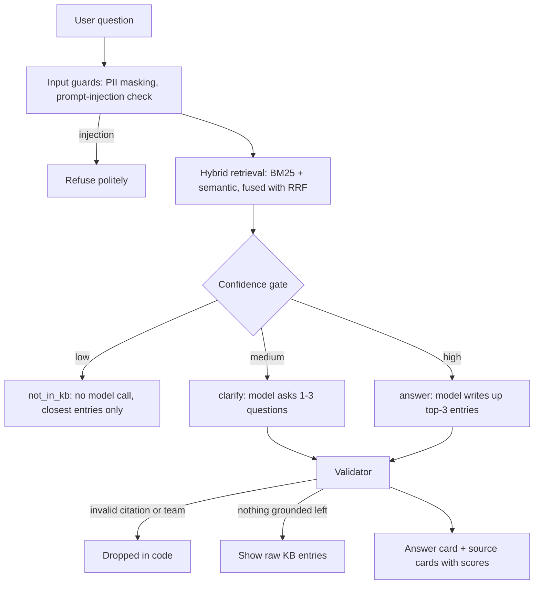

# TriageGPT: AI Troubleshooting Assistant for L1/L2 Support

A chat and search tool for support engineers. Describe an issue in plain language and the app finds the
relevant entries in a support knowledge base (KB), writes up step-by-step checks and an escalation team
from those entries, and shows exactly which entry each statement came from. When the KB does not cover
the issue it says so instead of guessing.

> **Sample data.** The KB is the manual of a fictional company, Northwind Payments. Every system, team,
> error code and procedure is simulated. It is not Pine Labs data.

The idea in one line: **the AI writes the answer, it does not decide what is true.** Retrieval and code
decide what the KB supports; the model only writes it up, and code checks the result.

## How it works



1. **Parse.** `lib/kb/parse.ts` turns the manual (67 entries, 15 teams, 4 priority levels) into structured data.
2. **Retrieve.** MiniSearch (BM25 with field boosts, prefix and fuzzy matching) catches exact codes such as
   `RC 91` or `504`. `bge-small-en-v1.5` embeddings catch paraphrases. Reciprocal Rank Fusion merges the two.
3. **Gate.** A deterministic rule on the retrieval scores picks `answer`, `clarify` or `not_in_kb` _before_
   any model call. For `not_in_kb` the model is never called.
4. **Generate.** The model sees only the top-3 entries and the escalation directory, and must return JSON
   matching a Zod schema in which every statement carries a `source_id`.
5. **Validate.** Code drops any statement citing an entry that was not retrieved and any escalation to a
   team that is not in the directory. If nothing grounded is left, the raw entries are shown instead.

Safety layers: card numbers (Luhn-checked), OTPs and CVVs are masked before logging or any provider call;
prompt-injection attempts are blocked by heuristics plus Groq Prompt Guard; model calls fall back across
providers on rate limits; repeated questions are cached and each IP is rate limited.

More detail and the reasoning behind each choice is in [docs/DECISIONS.md](docs/DECISIONS.md).

## Setup

Requires Node.js 22+.

```bash
npm install
cp .env.example .env.local   # add GROQ_API_KEY (and optionally GEMINI_API_KEY)
npm run build-index          # parses the KB and embeds it (downloads a ~30 MB model on first run)
npm run dev                  # http://localhost:3000
```

Without API keys the app still runs: retrieval, the gate, the guards and the source cards work, and
answers fall back to showing the raw KB entries.

| Command                                                       | What it does                                                                                     |
| ------------------------------------------------------------- | ------------------------------------------------------------------------------------------------ |
| `npm test`                                                    | Unit tests (parser, PII masker, injection heuristics, RRF, gate, validator, cache, pipeline)     |
| `npm run lint` / `npm run typecheck` / `npm run format:check` | Static checks                                                                                    |
| `npm run eval:retrieval`                                      | Hit@k and MRR for BM25 vs semantic vs hybrid                                                     |
| `npm run eval:gate`                                           | Decision confusion matrix without calling a model                                                |
| `npm run eval`                                                | Full evaluation with the model (needs keys, throttled for Groq's free tier, about 15-20 minutes) |

## Models

| Role                 | Model                                                                                 | Why                                                                                                                       |
| -------------------- | ------------------------------------------------------------------------------------- | ------------------------------------------------------------------------------------------------------------------------- |
| Answer writer        | Groq `openai/gpt-oss-120b`, falling back to other Groq models, then Gemini Flash-Lite | Free tier, fast; each Groq model has its own rate limit so falling back multiplies the quota; Gemini is a second provider |
| Injection classifier | Groq `meta-llama/llama-prompt-guard-2-86m`                                            | Free, high limits, cheap pre-filter                                                                                       |
| Embeddings           | `Xenova/bge-small-en-v1.5` (quantised, run locally with Transformers.js)              | Groq has no embeddings API; 67 entries need no vector database                                                            |

The chain is set by `LLM_MODELS` because model ids change often.

## Evaluation

The test set ([eval/testset.json](eval/testset.json)) has 52 hand-written questions: 10 in KB wording,
20 plain-language paraphrases, 5 error-code-only, 7 vague, 6 out of scope, 2 adversarial. Latest results
are in [eval/retrieval-report.md](eval/retrieval-report.md) and
[eval/report-gate-only.md](eval/report-gate-only.md).

Retrieval on the 37 answerable questions:

| Retriever     | Hit@1 | Hit@3 | MRR   |
| ------------- | ----- | ----- | ----- |
| BM25 only     | 83.8% | 97.3% | 0.908 |
| Semantic only | 94.6% | 97.3% | 0.955 |
| Hybrid (RRF)  | 91.9% | 97.3% | 0.948 |

Gate decisions on all 52 questions: 49 correct (94.2%) with **0 false answers on out-of-scope questions**.
Three misses: one error-code-only question sent to `clarify`, and two out-of-scope questions ("laptop VPN",
"Apple Pay") that got `clarify` rather than `not_in_kb`.

## Limitations

- **The thresholds were chosen by reading scores off this same 52-question set.** The 94.2% is therefore
  in-sample and optimistic. A held-out set would be the next step.
- 52 questions is small, and it was written by the project author, so it reflects one person's phrasing.
- Plain semantic scores from a small embedding model are compressed (roughly 0.45 to 0.90), so some
  out-of-scope questions that mention in-domain words (VPN, wifi) land in the "ask for more info" band.
- Hybrid retrieval did not beat semantic-only at Hit@1 on this set. Hybrid is kept because it was never
  worse at Hit@5 and exact error codes are a known weak spot for embeddings; this is a judgement, not a
  measured win.
- The model-written part is validated for citations and team names, but not yet scored for groundedness
  with an LLM judge; a manual spot-check is still to be done and recorded.
- If the KB entry itself is wrong, the assistant repeats it faithfully.
- Free-tier limits: Groq allows roughly 8K tokens per minute per model, and Gemini's free tier is very
  small and may use prompts to improve Google products. All data here is synthetic and PII is masked first;
  production would use a paid, no-retention tier.
- Running Transformers.js inside a serverless function depends on the host's size limits. If it does not
  fit, the app degrades to keyword-only retrieval (tested), and an embeddings API is the planned alternative.

## AI tools used

AI coding assistants were used for scaffolding, boilerplate, and drafting the sample KB. The architecture
(hybrid retrieval, no vector database, deterministic gate before the model, code-side citation validation),
the threshold choices, the test set, the prompt rules and the review of every file are the author's own
decisions.

## Repository layout

```
app/                 Next.js UI and the /api/ask route
components/          Answer card, sources panel, example prompts
lib/kb/              Manual parser and typed corpus
lib/retrieval/       BM25, semantic search, fusion, confidence gate
lib/llm/             Prompt (versioned), schema, model fallback chain
lib/guards/          PII masking, injection check, citation validator
lib/pipeline.ts      The end-to-end request flow
scripts/             Index build
eval/                Test set, runners and reports
tests/               Unit tests
docs/                Decision log
```
